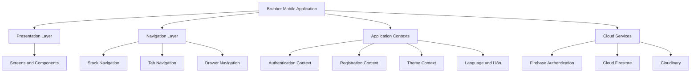
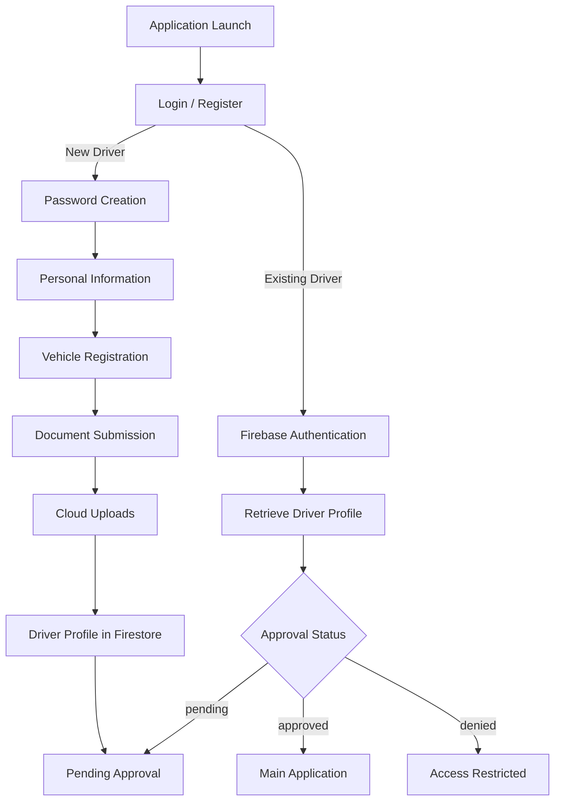

 
# BRUHBER
### Redefining the Driver Experience. Engineering the Future of Mobility.

<p align="center">
  <strong>A next-generation driver-focused mobility platform.</strong>
  <br/>
  An ambitious mobile application designed to streamline driver onboarding, identity verification, vehicle registration, and the management of a modern transportation ecosystem.
</p>

<p align="center">
  
  
  
  
</p>

---

## 01. Project Overview

**Bruhber** is a mobile application project inspired by modern ride-hailing platforms, with a particular focus on the driver's experience.

The project aims to establish a digital ecosystem where drivers can register, submit their personal information, document their vehicles, upload the required documentation, and manage their account through a centralized mobile interface.

Rather than approaching transportation as a simple connection between passengers and drivers, Bruhber begins by building the technological foundation required to manage the driver lifecycle.

From initial registration to account approval, every stage is designed around structured information, cloud-based services, and a scalable application architecture.

### Our Vision

To develop a comprehensive mobility platform that prioritizes operational efficiency, accessibility, and a streamlined driver experience.

Bruhber is the foundation of a broader technological ecosystem, designed with future expansion and additional mobility services in mind.

---

## 02. Core Features

### Driver Registration & Onboarding

A multi-step registration experience designed to collect and organize all the information required to onboard a new driver.

- Personal information and identity details.
- Profile photograph selection.
- Vehicle registration and classification.
- Vehicle specifications and photographic evidence.
- Driving license information.
- SOAT documentation and expiration dates.
- Payment account information.
- Terms and conditions acceptance.

### Authentication & Account Management

Secure authentication powered by Firebase Authentication.

- Email and password registration.
- Driver login.
- Authentication state management.
- Driver profile retrieval from Firestore.
- Account approval status verification.
- Automatic navigation according to account status.

### Administrative Approval Workflow

Drivers are not automatically granted access to the operational application after registration.

Each account has an approval status:

| Status | Description |
|---|---|
| `pending` | Registration submitted and awaiting review. |
| `approved` | Driver authorized to access the application. |
| `denied` | Driver application not approved. |

This structure establishes the foundation for a controlled driver onboarding process.

### Internationalization

Bruhber incorporates multilingual support through i18next.

- Spanish language support.
- English language support.
- Centralized translation resources.
- Runtime language switching.

### Dynamic Appearance

A centralized theme system allows users to customize the application's appearance.

- Light theme.
- Dark theme.
- Shared theme configuration across screens.
- Consistent visual styling.

### Cloud-Based Image Management

Driver photographs, vehicle images, and documentation are uploaded through Cloudinary.

This approach separates image delivery and media management from the application's primary database.

---

## 03. Technology Stack

Bruhber combines modern mobile development technologies with cloud infrastructure.

| Technology | Purpose |
|---|---|
| React Native | Cross-platform mobile interface. |
| Expo SDK 57 | Development environment and native integrations. |
| React 19 | Component-based application architecture. |
| React Navigation | Application navigation. |
| Firebase Authentication | User authentication. |
| Cloud Firestore | Driver information and application data. |
| Cloudinary | Image and document media management. |
| i18next | Internationalization and translations. |
| React Context API | Shared application state. |
| JavaScript | Application logic and functionality. |

### Application Infrastructure

The architecture separates the main responsibilities of the application:



---

## 04. Driver Lifecycle

The application follows a structured onboarding process.



### Account Data Structure

Driver information is organized within the Firestore `drivers` collection.

A driver document follows this general structure:

```json
{
  "approvalStatus": "pending",
  "availabilityStatus": "unavailable",
  "createdAt": "Firestore Timestamp",

  "personalData": {
    "fullName": "...",
    "documentNumber": "...",
    "phone": "...",
    "email": "...",
    "birthDate": "...",
    "gender": "...",
    "language": "...",
    "profilePhoto": {}
  },

  "vehicle": {
    "vehicleCategory": "...",
    "vehiclePlate": "...",
    "vehicleBrand": "...",
    "vehicleModel": "...",
    "vehicleYear": 2022,
    "vehicleColor": "...",
    "vehicleCapacity": 4,
    "vehiclePhoto": {}
  },

  "documents": {
    "licenseNumber": "...",
    "licenseExpiration": "...",
    "licensePhoto": {},
    "soatExpiration": "...",
    "soatPhoto": {},
    "paymentEmail": "...",
    "acceptedTerms": true
  }
}
```

*This is a representative structure. Actual documents contain additional metadata, including Cloudinary asset references.*

---

## 05. Business Model

Bruhber establishes a transparent commission structure for its transportation services.

| Concept | Distribution |
|---|---:|
| Platform commission | 20% |
| Driver earnings from each trip | 80% |
| Driver tips | 100% |

The platform's commission model is designed to support the sustainability and continued development of the ecosystem while preserving the driver's ownership of their tips.

---

## 06. Project Structure

The application follows a modular organization that separates navigation, screens, contexts, configuration, and services.

```text
Bruhber/
│
├── assets/
│
├── src/
│   ├── config/
│   │   ├── firebase.js
│   │   └── i18n.js
│   │
│   ├── context/
│   │   ├── AuthContext.js
│   │   ├── RegistrationContext.js
│   │   ├── ThemeContext.js
│   │   └── LanguageContext.js
│   │
│   ├── locales/
│   │   ├── en/
│   │   │   └── translation.json
│   │   └── es/
│   │       └── translation.json
│   │
│   ├── navigation/
│   │   ├── RootNavigator.js
│   │   ├── AuthNavigator.js
│   │   └── RegistrationNavigator.js
│   │
│   ├── screens/
│   │   ├── auth/
│   │   ├── registration/
│   │   ├── approval/
│   │   └── app/
│   │
│   └── services/
│       └── driverScreen.js
│
├── App.js
├── app.json
├── package.json
└── README.md
```

*The structure above represents the main architectural organization; individual filenames and additional components may vary.*

---

## 07. Getting Started

### Prerequisites

Before running Bruhber, make sure you have:

- Node.js and npm installed.
- Expo development environment.
- Expo Go or an appropriate development build.
- A Firebase project.
- A Cloudinary account.

### Installation

Clone the repository:

```bash
git clone https://github.com/INddestable/Br_uhber.git
```

Navigate to the project directory:

```bash
cd Bruhber
```

Install dependencies:

```bash
npm install
```

Start the Expo development server:

```bash
npx expo start
```

Follow the instructions displayed in the terminal to launch the application.

---

## 08. Cloud Configuration

Bruhber relies on external cloud services for authentication, data persistence, and media management.

### Firebase

Create a Firebase project and configure the following services:

1. Firebase Authentication.
2. Email/Password authentication provider.
3. Cloud Firestore database.

Configure the Firebase application credentials in:

```text
src/config/firebase.js
```

The application uses Firebase Authentication for account management and Cloud Firestore for driver profile persistence.

**Security considerations:**

- Never publish Firebase service account private keys.
- Protect Firestore data using appropriate security rules.
- Validate authenticated users and document ownership.
- Do not rely exclusively on client-side validation for sensitive operations.

Firebase client configuration values are not equivalent to private service account credentials. Database security rules remain essential.

### Cloudinary

Create a Cloudinary account and configure an unsigned upload preset.

The application uses Cloudinary to manage uploaded driver photographs, vehicle images, and documentation.

Configure the cloud name and upload preset in the corresponding application service.

**Important:** Unsigned upload presets are publicly usable. Restrict allowed formats, file sizes, and upload settings. Never expose your Cloudinary API Secret in the mobile application or repository.

---

## 09. Development Roadmap

Bruhber is designed to evolve beyond its initial driver onboarding implementation.

The following roadmap distinguishes the current foundation from potential future development.

### Implemented

- [x] Mobile application foundation.
- [x] Firebase Authentication integration.
- [x] Cloud Firestore integration.
- [x] Multi-step driver registration.
- [x] Personal information management.
- [x] Vehicle registration.
- [x] Document submission.
- [x] Cloudinary media uploads.
- [x] Driver approval status handling.
- [x] Pending approval screen.
- [x] Authentication-based navigation.
- [x] Spanish and English translations.
- [x] Light and dark themes.
- [x] Centralized application contexts.

### Planned

- [ ] Complete driver dashboard.
- [ ] Driver availability management.
- [ ] Real-time trip request management.
- [ ] Trip lifecycle and status tracking.
- [ ] Earnings dashboard.
- [ ] Trip history.
- [ ] Driver profile management.
- [ ] Administrative approval interface.
- [ ] Passenger-side application.
- [ ] Real-time location and navigation services.
- [ ] Notifications and operational alerts.

*Planned features are not necessarily available in the current version.*

---

## 10. Project Philosophy

Bruhber is not intended to be just another interface built around a collection of screens.

Its development focuses on establishing a modular foundation capable of supporting a larger mobility ecosystem.

The project emphasizes:

- **Modularity:** Independent application responsibilities and reusable components.
- **Scalability:** A cloud-based foundation for future expansion.
- **Maintainability:** Organized application logic and centralized configuration.
- **Accessibility:** Multilingual support and customizable appearance.
- **Data organization:** Structured driver information and document management.
- **Security awareness:** Authentication, database access control, and responsible credential management.

Every implemented component contributes to the foundation of a more comprehensive platform.

---

## 11. Acknowledgements

Developed as a software engineering academic project, exploring mobile application development, cloud infrastructure, authentication systems, data persistence, and modern application architecture.

**Bruhber — Building the foundation for a smarter mobility ecosystem.**

<p align="center">
  <strong>One platform. Multiple possibilities. A new direction for mobility.</strong>
</p>

## 12. AI Usage Disclosure

Artificial intelligence tools were used as supporting resources throughout the development of Bruhber.

Their use included technical research, Firebase and Cloudinary integration guidance, internationalization, theme management, troubleshooting, and documentation support.

All relevant AI-assisted activities are documented in the project's AI usage log.

**Full documentation:** [AI Usage Log](docs/AI_LOG.md)